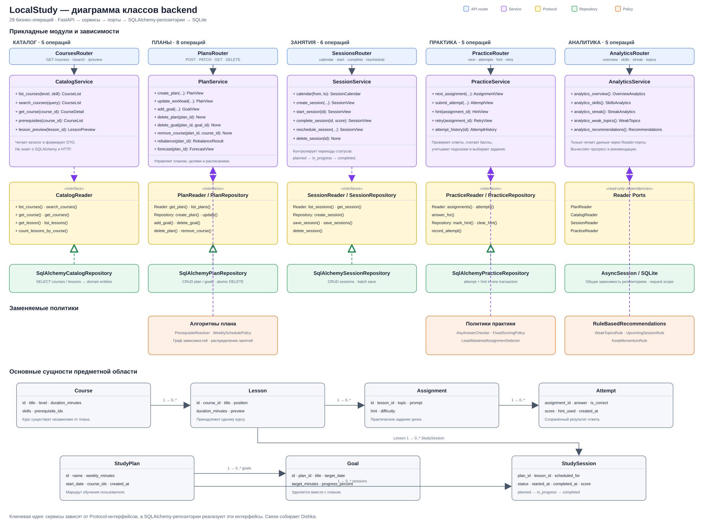
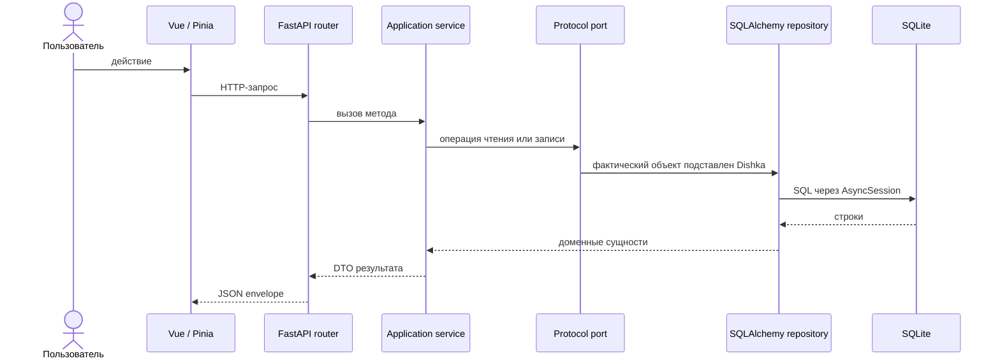
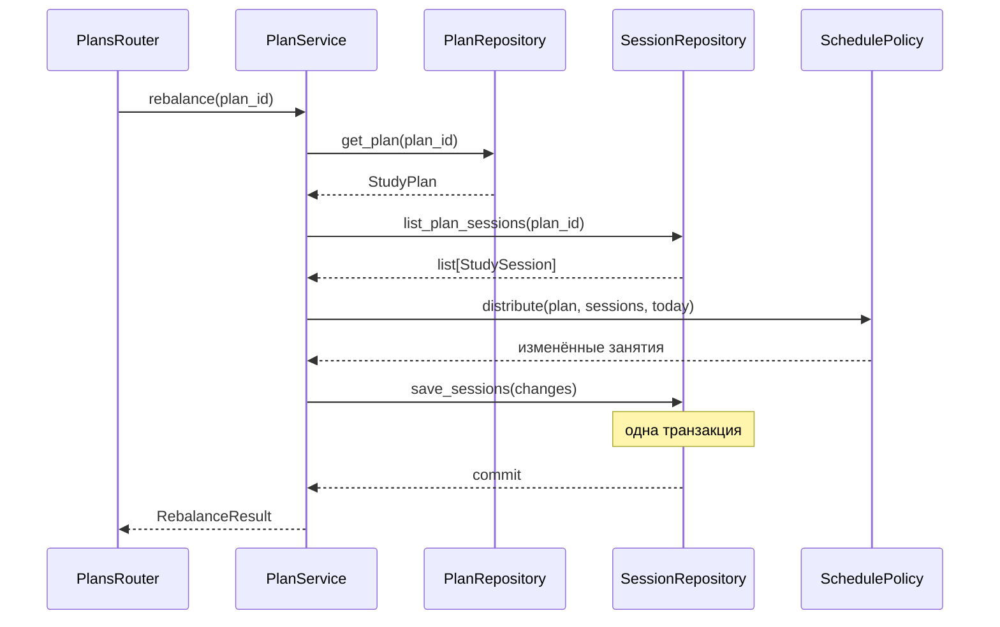
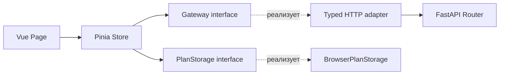

# Диаграмма классов LocalStudy

Диаграмма показывает основную структуру backend: от HTTP-маршрутов до прикладных сервисов, портов, репозиториев, политик и сущностей предметной области.

[Открыть SVG в полном размере](diagrams/localstudy-class-diagram.svg) · [Открыть PNG](diagrams/localstudy-class-diagram.png)

## Как читать диаграмму

| Обозначение | Смысл |
|---|---|
| Синий блок | FastAPI router. Принимает HTTP-запрос, проверяет входные данные и вызывает сервис. |
| Фиолетовый блок | Прикладной сервис. Выполняет один пользовательский сценарий и координирует зависимости. |
| Жёлтый блок | `Protocol`, то есть интерфейс, который нужен сервису. |
| Зелёный блок | Реализация порта на SQLAlchemy. Она знает устройство базы данных. |
| Оранжевый блок | Заменяемый алгоритм: расписание, проверка ответа, начисление баллов или рекомендация. |
| Серый блок | Сущность предметной области. Это данные и состояния, не зависящие от FastAPI и SQLAlchemy. |
| Сплошная стрелка | Объект вызывает другой объект. |
| Пунктир с пустым треугольником | Класс реализует интерфейс. |
| Фиолетовый пунктир | Сервис получает заменяемую политику через DI-контейнер. |

## Общий путь запроса

На этапе выполнения отдельного объекта `Port` нет. Например, конструктор `PlanService` ожидает `PlanRepository`, а Dishka передаёт в него экземпляр `SqlAlchemyPlanRepository`. Интерфейс нужен для того, чтобы сервис зависел от контракта, а SQLAlchemy оставался деталью инфраструктуры.

## Прикладные сервисы

### `CatalogService`

Отвечает только за каталог. Через `CatalogReader` он получает курсы и уроки, затем превращает доменные сущности в DTO для API.

| Метод | Что делает |
|---|---|
| `list_courses(level, skill)` | Возвращает курсы с необязательной фильтрацией по уровню и навыку. |
| `search_courses(query)` | Ищет курсы по строке без учёта регистра. |
| `get_course(course_id)` | Возвращает один курс или сообщает, что он не найден. |
| `prerequisites(course_id)` | Строит полный порядок обязательных курсов через `PrerequisiteResolver`. |
| `lesson_preview(lesson_id)` | Возвращает краткую информацию и содержимое предпросмотра урока. |

### `PlanService`

Управляет учебным планом, целями и перестроением расписания. Он не выполняет SQL сам: чтение каталога идёт через `CatalogReader`, запись плана через `PlanRepository`, занятия через `SessionRepository`.

| Метод | Что делает |
|---|---|
| `create_plan(...)` | Проверяет курсы, добавляет обязательные зависимости и создаёт план. |
| `update_workload(...)` | Изменяет недельную нагрузку. |
| `add_goal(...)` | Добавляет цель с датой, временем и начальным прогрессом. |
| `delete_plan(plan_id)` | Удаляет план, его цели и занятия одной атомарной операцией репозитория. |
| `delete_goal(plan_id, goal_id)` | Удаляет конкретную цель только из указанного плана. |
| `remove_course(...)` | Удаляет курс из маршрута и будущие занятия по его урокам. |
| `rebalance(plan_id)` | Передаёт занятия в `SchedulePolicy`, затем сохраняет пакет изменений. |
| `forecast(plan_id)` | Оценивает срок завершения плана по объёму курса и недельной нагрузке. |

`PrerequisiteResolver` выполняет обход графа зависимостей курсов. Благодаря отдельному классу `PlanService` не содержит алгоритм обхода и может использовать готовый упорядоченный список.

### `SessionService`

Управляет календарём и жизненным циклом занятия.

| Метод | Что делает |
|---|---|
| `calendar(from_date, to_date)` | Возвращает занятия за период в хронологическом порядке. |
| `create_session(...)` | Проверяет план и урок, затем создаёт запланированное занятие. |
| `start_session(session_id)` | Переводит занятие из `planned` в `in_progress`. |
| `complete_session(session_id, score)` | Завершает начатое занятие и сохраняет результат. |
| `reschedule_session(...)` | Переносит будущее запланированное занятие. |
| `delete_session(session_id)` | Удаляет только занятие в состоянии `planned`. |

Переходы состояния ограничены цепочкой `planned → in_progress → completed`. Эти проверки не позволяют завершить ещё не начатое занятие или удалить уже завершённое.

### `PracticeService`

Организует практическое задание, подсказку и проверку ответа.

| Метод | Что делает |
|---|---|
| `next_assignment(plan_id)` | Выбирает следующее задание только из уроков текущего учебного маршрута. |
| `submit_attempt(...)` | Проверяет ответ, считает баллы и сохраняет попытку. |
| `hint(assignment_id)` | Возвращает подсказку и отмечает, что она была использована. |
| `retry(assignment_id)` | Сбрасывает отметку о подсказке и возвращает задание повторно. |
| `attempt_history(assignment_id)` | Возвращает историю попыток по заданию. |

Внутри используются три независимых контракта:

- `AnswerChecker` определяет правильность ответа;
- `ScoringPolicy` определяет обычный балл и штраф за подсказку;
- `AssignmentSelector` выбирает следующее задание.

`SqlAlchemyPracticeRepository.record_attempt()` в одной транзакции читает отметку о подсказке, выбирает нужный балл, сохраняет попытку и сбрасывает отметку. При ошибке откатываются оба изменения.

### `AnalyticsService`

Только читает данные через узкие Reader-интерфейсы. Это защищает аналитику от случайного изменения планов, занятий и попыток.

| Метод | Что делает |
|---|---|
| `analytics_overview()` | Считает общий прогресс и учебное время. |
| `analytics_skills()` | Группирует прогресс по навыкам. |
| `analytics_streak()` | Считает непрерывную серию учебных дней. |
| `analytics_weak_topics()` | Находит темы с наиболее слабыми результатами. |
| `analytics_recommendations()` | Собирает рекомендации из независимых правил. |

`RuleBasedRecommendations` последовательно запускает `WeakTopicsRule`, `UpcomingSessionRule` и `KeepMomentumRule`, а затем объединяет их результаты. Новое правило можно добавить в композицию без изменения `AnalyticsService`.

## Порты и репозитории

Порты объявлены в `backend/src/application/ports.py` с помощью `typing.Protocol`. Для Python это структурная типизация: класс подходит интерфейсу, если у него есть методы с нужными сигнатурами.

| Порт | Реализация | Ответственность |
|---|---|---|
| `CatalogReader` | `SqlAlchemyCatalogRepository` | Курсы, уроки, поиск и подсчёт уроков. |
| `PlanReader` | `SqlAlchemyPlanRepository` | Только чтение планов. |
| `PlanRepository` | `SqlAlchemyPlanRepository` | Создание и изменение плана и целей. Наследует операции `PlanReader`. |
| `SessionReader` | `SqlAlchemySessionRepository` | Только чтение занятий. |
| `SessionRepository` | `SqlAlchemySessionRepository` | Создание, изменение, пакетное сохранение и удаление занятий. |
| `PracticeReader` | `SqlAlchemyPracticeRepository` | Задания, ответы и история попыток. |
| `PracticeRepository` | `SqlAlchemyPracticeRepository` | Подсказки и атомарное сохранение попытки. |
| `Clock` | `SystemClock` | Текущая дата и время без прямых вызовов системных часов из сервисов. |

Разделение на `Reader` и `Repository` следует принципу разделения интерфейсов. Класс, которому нужно только чтение, не получает методы записи.

## Связи доменных сущностей

| Связь | Объяснение |
|---|---|
| `Course 1 → 0..* Lesson` | Курс содержит упорядоченные уроки. `Lesson.course_id` указывает на курс. |
| `Lesson 1 → 0..* Assignment` | У урока может быть несколько практических заданий. |
| `Assignment 1 → 0..* Attempt` | Каждая попытка относится к одному заданию. |
| `StudyPlan 1 → 0..* Goal` | Цель принадлежит одному плану и удаляется вместе с ним. |
| `StudyPlan 1 → 0..* StudySession` | Все занятия создаются в контексте конкретного плана. |
| `Lesson 1 → 0..* StudySession` | Занятие планирует прохождение конкретного урока. |
| `Course → prerequisite_ids` | Курс хранит идентификаторы обязательных курсов; полный порядок строит `PrerequisiteResolver`. |

Доменные сущности реализованы как неизменяемые `dataclass` с `slots=True`. Они не содержат ORM-полей, HTTP-статусов и методов FastAPI. Репозитории преобразуют SQLAlchemy-модели в эти объекты перед возвратом в сервис.

### Три представления одних данных

Данные проходят через три вида классов. У каждого вида своя задача:

| Слой | Пример | Зачем нужен |
|---|---|---|
| ORM-модель | `CourseModel`, `PlanModel`, `SessionModel` | Описывает таблицу, тип столбца, первичный и внешний ключ. Используется только инфраструктурой. |
| Доменная сущность | `Course`, `StudyPlan`, `StudySession` | Представляет данные внутри бизнес-логики без зависимости от SQLAlchemy. |
| DTO | `CourseDetail`, `PlanView`, `SessionView` | Определяет данные, которые прикладной сценарий возвращает API. |

Полное соответствие ORM-моделей: `CourseModel → Course`, `LessonModel → Lesson`, `PlanModel → StudyPlan`, `GoalModel → Goal`, `SessionModel → StudySession`, `AssignmentModel → Assignment`, `AttemptModel → Attempt`. Поля `expected_answer` и `hint_requested` остаются внутри инфраструктуры: клиент не должен получать правильный ответ и служебную отметку до проверки попытки.

## Как Dishka связывает классы

`ApplicationProvider` в `backend/src/api/dependency_injection/container.py` является точкой сборки приложения:

1. На всё время жизни приложения создаётся `AsyncEngine`.
2. На каждый HTTP-запрос создаётся отдельный `AsyncSession`.
3. Из этой сессии создаются четыре SQLAlchemy-репозитория.
4. Репозитории регистрируются как реализации соответствующих портов.
5. Политики и `SystemClock` также регистрируются по интерфейсам.
6. Dishka анализирует конструктор нужного сервиса и передаёт готовые зависимости.

Сервисы не создают репозитории через `SqlAlchemy...Repository()` и не читают глобальную переменную базы. Поэтому в модульном тесте вместо базы можно передать простой объект в памяти, который реализует тот же Protocol.

## Пример: перестроение расписания

Политика только рассчитывает новые даты. Репозиторий только сохраняет результат. Сервис управляет последовательностью действий и обрабатывает прикладные ошибки.

## Frontend и backend

Frontend использует ту же идею зависимостей, хотя это не основной классический участок UML-диаграммы:

`frontend/src/app/dependencies.ts` передаёт stores конкретные HTTP-адаптеры и `BrowserPlanStorage`. Страница работает со store, store — с интерфейсом gateway, а вызов `fetch` сосредоточен в общем HTTP-клиенте.

## Как здесь проявляется SOLID

| Принцип | Реализация в проекте |
|---|---|
| **S — Single Responsibility** | Router отвечает за HTTP, service — за сценарий, repository — за хранение, policy — за один алгоритм. |
| **O — Open/Closed** | Проверки ответов и правила рекомендаций расширяются новыми реализациями интерфейса. Сервис менять не требуется. |
| **L — Liskov Substitution** | SQLAlchemy-репозиторий и тестовый репозиторий в памяти выполняют один контракт порта. Общие контрактные тесты проверяют одинаковое поведение. |
| **I — Interface Segregation** | Для чтения существуют `PlanReader`, `SessionReader`, `PracticeReader`; методы записи доступны только тем сервисам, которым они нужны. |
| **D — Dependency Inversion** | Сервисы зависят от Protocol-интерфейсов. Конкретные классы SQLAlchemy подключаются снаружи через Dishka. |

Главная мысль архитектуры: прикладной код знает, **что** нужно получить или сохранить, но не знает, **как именно** это делает SQLite. Конкретный способ хранения можно заменить при сохранении поведения портов.
